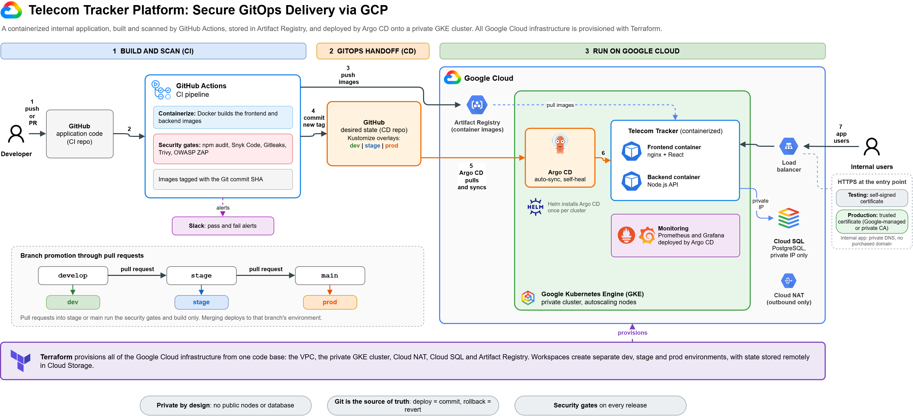
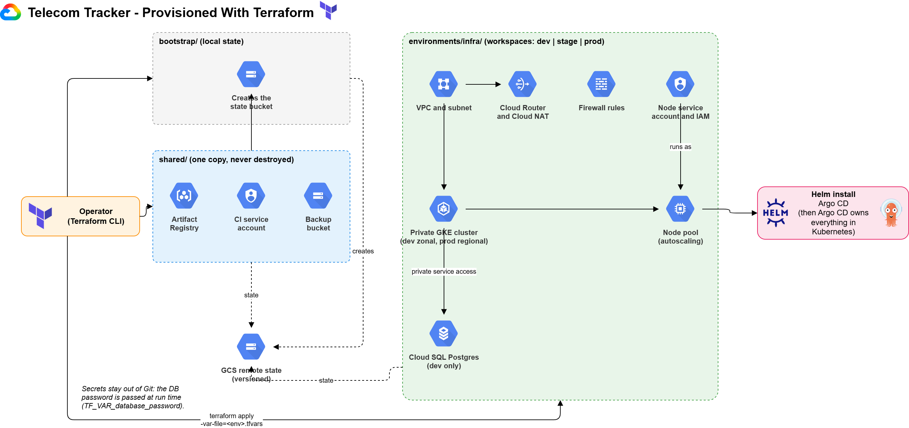
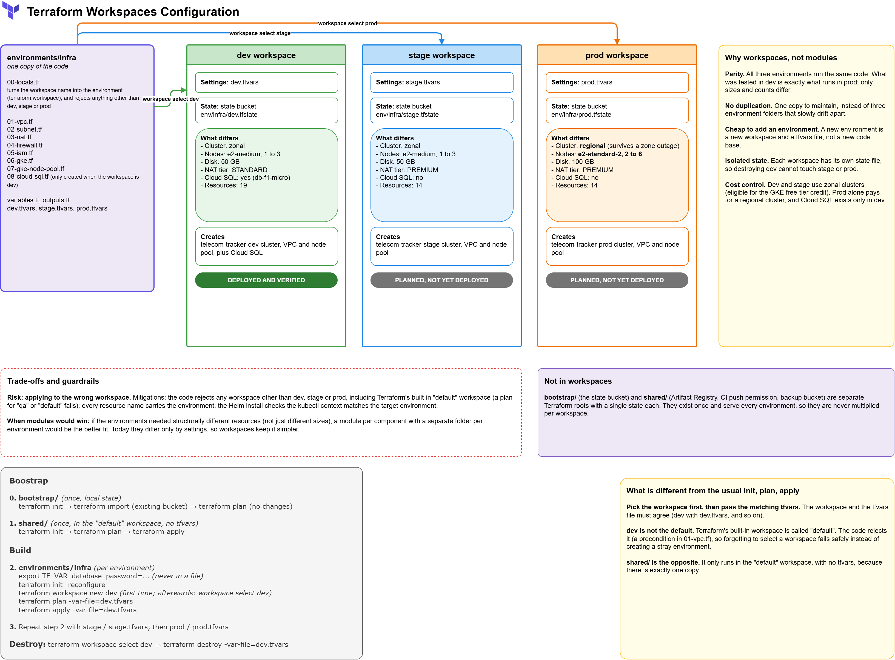
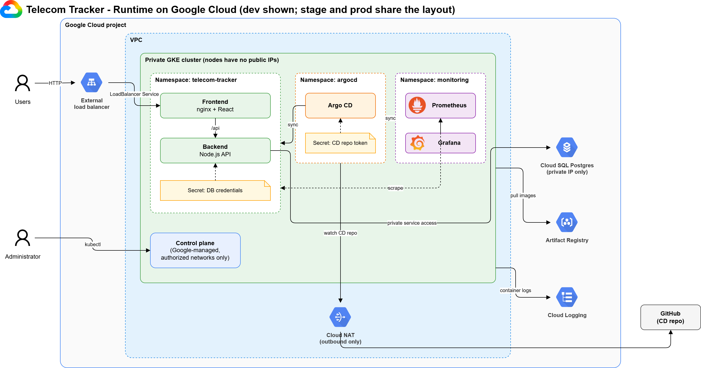
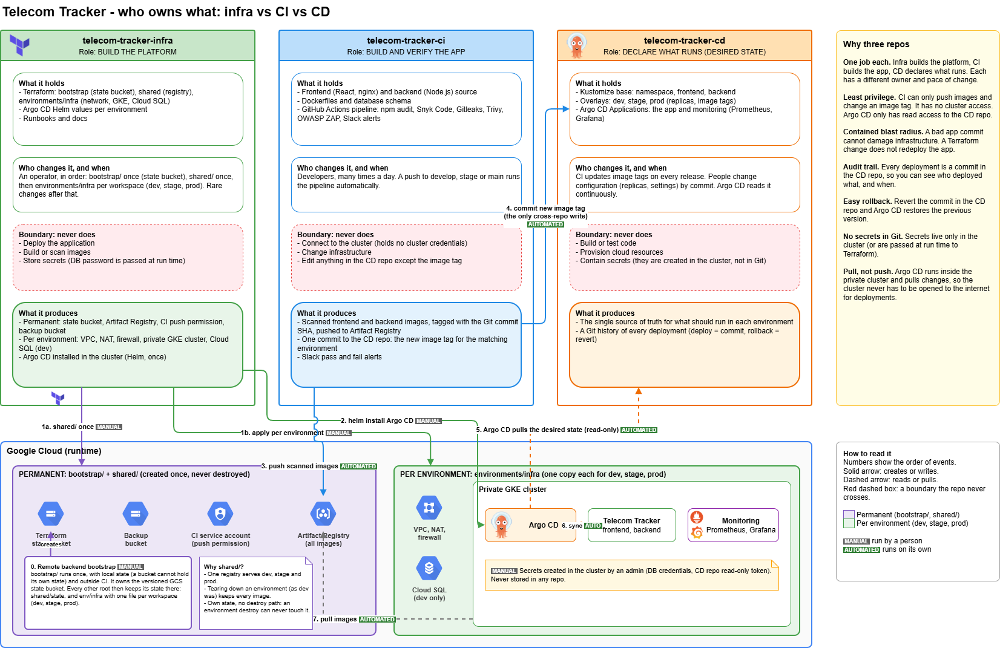
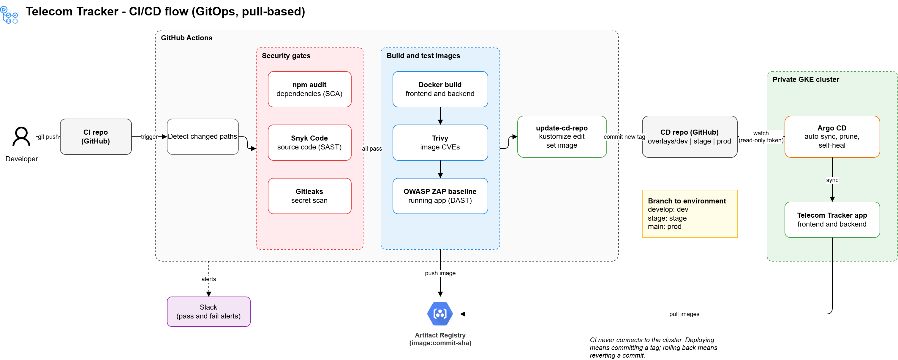
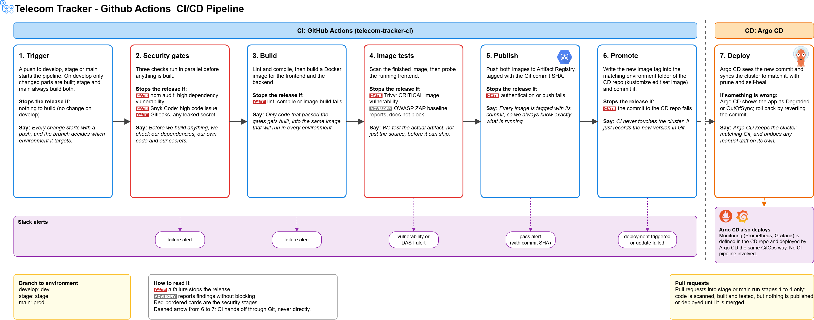
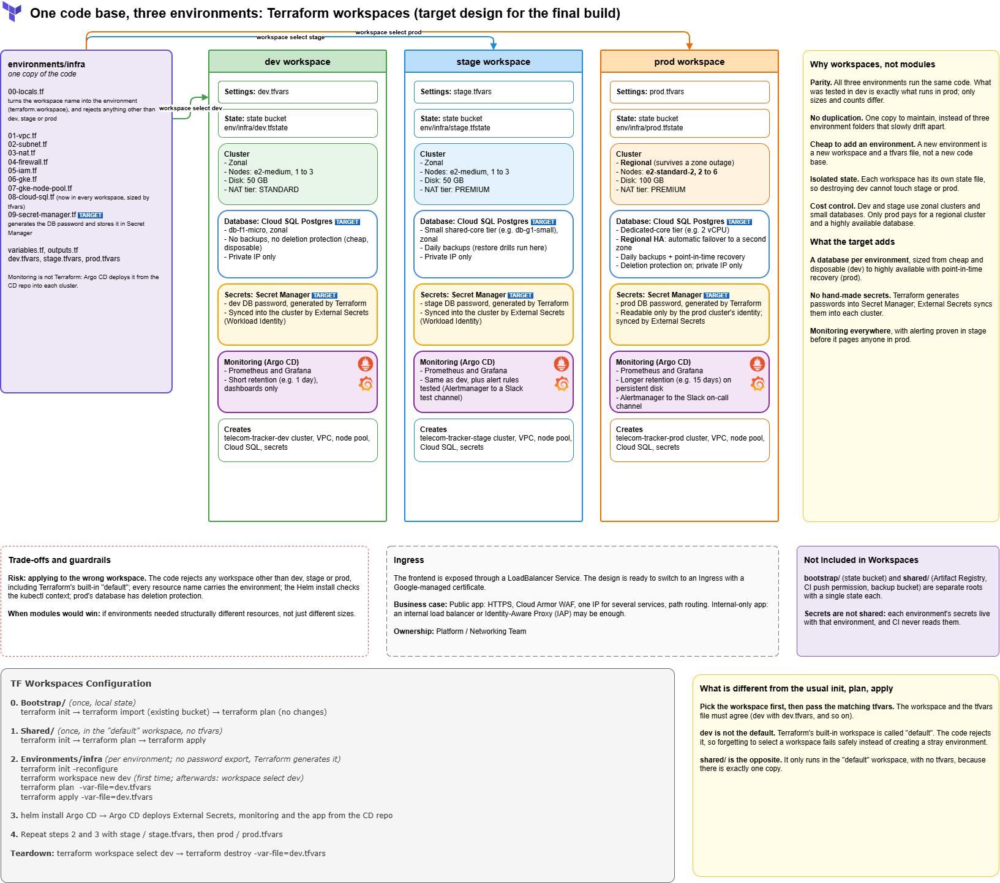

# Telecom Tracker Platform: Secure, Scalable GitOps Infrastructure on Google Cloud

**Highly available, secure and scalable infrastructure for a critical internal application, built on Google Cloud with Terraform, GitHub Actions and Argo CD.**

---

## 1. Business Problem

Telecom Tracker is a critical internal application: project status, files, and quality checks for fiber, 5G, and backhaul builds live there. The organization needed somewhere that application could run safely every day—not a temporary host, and not a one-off cloud setup that only a few people understood.

What was missing was a platform: isolated paths from change to production, a private network and database, security checks in the delivery path, and infrastructure that could be built, torn down, and rebuilt from code. The goal was to keep the application available, auditable, and cost-aware as load and the team grew. The requirements were:

- **Isolated environments.** Separate dev, stage and prod, so changes are tested before they reach users.
- **Nothing exposed that doesn't need to be.** No public addresses on servers or the database.
- **Security in the delivery path.** Every release is scanned before it can be deployed.
- **Auditable, reversible changes.** Every change is traceable to a commit and can be rolled back.
- **Repeatable.** Environments can be built, torn down and rebuilt from code on demand.
- **Ready to scale and survive failures.** Capacity grows with load, and production tolerates a zone outage.
- **Cost-aware.** Non-production environments stay small; only production pays for redundancy.

## 2. The platform

The platform is a private Google Cloud footprint for Telecom Tracker: infrastructure from Terraform, images through a gated GitHub Actions pipeline, and delivery by Argo CD inside the cluster. Dev, stage, and prod share one code base; only production pays for full redundancy. The building blocks are:

- **Private Google Kubernetes Engine (GKE) cluster.** Nodes have no public IPs, and the control plane only accepts admin connections from an allowlist.
- **Terraform for all cloud infrastructure.** Three roots with separate state. One code base produces dev, stage and prod through Terraform workspaces.
- **GitHub Actions pipeline with security gates.** Dependency, code, secret and image scans run before an image is published.
- **GitOps delivery with Argo CD.** Argo CD runs inside the cluster and pulls the desired state from Git. The pipeline never touches the cluster.
- **Cloud SQL for PostgreSQL on a private IP.** The database is reachable only from inside the private network.

## 3. Architecture diagrams

Click any diagram to open it at full size.

### Provisioned with Terraform

Terraform builds everything in Google Cloud, split into three roots with their own state:

- `bootstrap/` creates the bucket that stores Terraform's state.
- `shared/` holds what every environment uses, such as the container registry, and is never destroyed.
- `environments/infra/` builds the network, the private cluster and the database for each environment.

Terraform stops at the cluster. Helm installs Argo CD once, and from then on Argo CD owns everything inside Kubernetes.

### Terraform workspaces configuration

One code base produces all three environments. The workspace name selects the environment, and a settings file per environment sets the sizes. This keeps the environments identical in structure, so what was tested in dev is what runs in prod. Dev validated the pattern end to end; stage and prod apply the same code through their own workspaces.

### Runtime on Google Cloud

What runs where, and what is private. The nodes have no public IPs and reach the internet only through Cloud NAT. The database is reachable only over the private network. Only the application's frontend is exposed. Argo CD and the monitoring stack run inside the cluster.

### Who owns what: infra vs CI vs CD

The platform is split across three repositories, each with one job and its own permissions. Infra builds the cloud. CI builds and scans the images. CD declares what runs. The diagram also separates permanent resources from per-environment ones, and manual steps from automated ones.

### CI/CD flow

The pull-based GitOps model. The pipeline scans and builds images, pushes them to Artifact Registry, and records the new image tag in the CD repo. Argo CD, inside the private cluster, sees the commit and syncs. Deploying means committing; rolling back means reverting.

### GitHub Actions pipeline stages

Seven stages from push to deployment, showing what blocks a release at each one. Results go to Slack. The `develop`, `stage` and `main` branches deploy to dev, stage and prod respectively.

### Production design: dev, stage and prod

Every environment gets its own database, secrets in Secret Manager, and monitoring. Prod gets a highly available database with point-in-time recovery. The entry point is designed to switch to Ingress once the access model is decided. See the [production design](docs/roadmap.md).

## 4. The workload

The platform hosts Telecom Tracker, an internal application that tracks telecom infrastructure projects such as fiber, 5G and backhaul builds. It's a three-tier application: a React frontend served by nginx, a Node.js API, and a PostgreSQL database. It's critical because project status, files and quality checks live there. That is why it needs isolated environments, a private database and a secured delivery path.

## 5. Production design

The platform is built in stages on one Terraform code base. Dev validated the full pattern end to end. Stage and prod apply the same code through their own workspaces, with the hardening each role requires:

- a database per environment, with regional high availability and point-in-time recovery in prod
- secrets in Google Secret Manager, synced into each cluster
- monitoring and alerting in every environment
- keyless pipeline authentication (Workload Identity Federation)
- review gates on promotion: branch protection on stage and main, with a required approval and passing CI checks
- an entry point matched to the audience: public or internal access, and who owns it

Details are in [`docs/roadmap.md`](docs/roadmap.md). The reasoning behind the main design choices is in [`docs/decisions.md`](docs/decisions.md).

## 6. Tech stack

| Area | Tools |
| --- | --- |
| Cloud | Google Cloud: GKE, Cloud SQL, Artifact Registry, Cloud NAT, Cloud Storage |
| Infrastructure as code | Terraform (workspaces, remote state), Helm |
| CI | GitHub Actions, Docker, npm audit, Snyk, Gitleaks, Trivy, OWASP ZAP, Slack |
| CD | Argo CD, Kustomize |
| Observability | Prometheus, Grafana |
| Workload | React, nginx, Node.js, PostgreSQL |

## 7. Business Value

| Business benefit | Why it matters |
| --- | --- |
| Safer change management | Dev, stage, and prod stay isolated so work is proven before it reaches users. |
| Reduced attack surface | Servers and the database stay off the public internet; only the frontend is exposed. |
| Security in every release | Dependency, code, secret, and image scans block unsafe builds before deploy. |
| Auditability and rollback | Every change maps to a Git commit and can be reverted the same way. |
| Repeatable environments | Environments are built and rebuilt from code, cutting snowflake drift and rebuild time. |
| Resilience under load and failure | Capacity scales with demand; production is designed to tolerate a zone outage. |
| Cost control | Non-production stays small; only production pays for high availability. |
| Faster, lower-risk delivery | GitOps was proven end to end: push → scan → image → Argo CD sync → live app. |
| Operational visibility | Prometheus and Grafana give cluster and workload metrics without a separate install path. |

*(Application and infrastructure source code lives in private repositories and is not included here.)*
