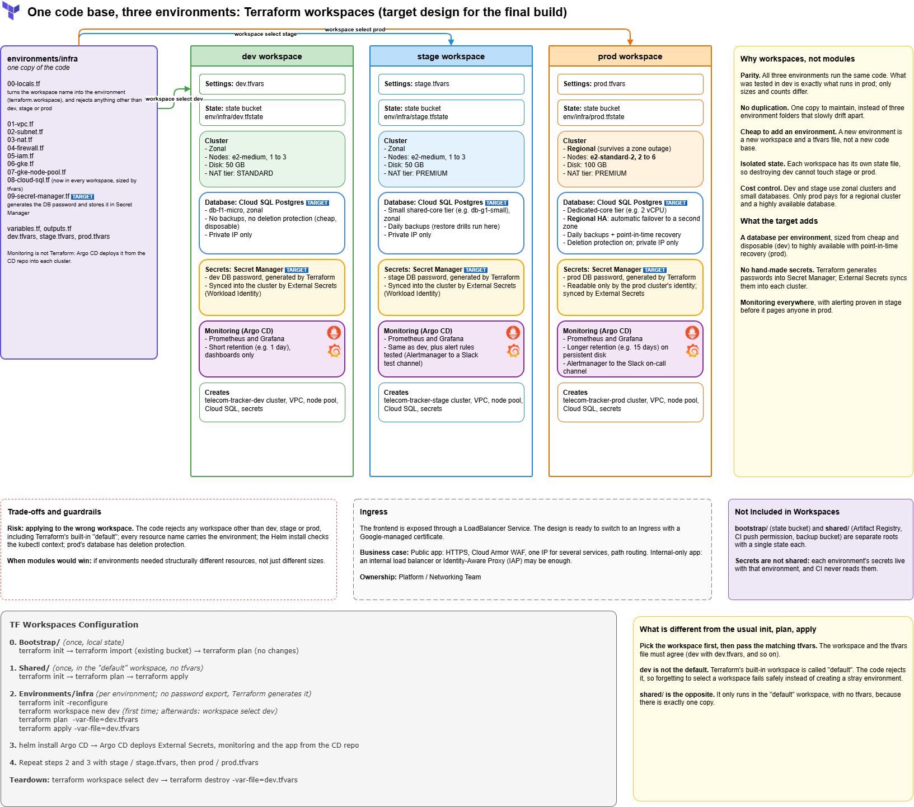

# Production design: dev, stage and prod

The platform is built in stages on one Terraform code base. Dev validated the full pattern end to end: provisioning, the security-gated pipeline, GitOps delivery and monitoring. Stage and prod apply the same code through their own workspaces, each with the availability, recovery and security controls its role requires. Click the diagram to open it at full size.

## What each environment gets

Sizes marked "e.g." are examples, tuned per environment through its settings file.

| | dev | stage | prod |
| --- | --- | --- | --- |
| Cluster | Zonal, 1 to 3 small nodes | Zonal, 1 to 3 small nodes | Regional (survives a zone outage), 2 to 6 larger nodes |
| Database | Smallest tier, no backups (cheap and disposable) | Small tier (e.g. db-g1-small), daily backups, restore drills | Dedicated tier (e.g. 2 vCPU), high availability, point-in-time recovery, deletion protection |
| Secrets | Secret Manager | Secret Manager | Secret Manager, readable only by the prod cluster |
| Monitoring | Prometheus and Grafana, short retention (e.g. 1 day) | Same, plus alert rules tested against a Slack test channel | Longer retention (e.g. 15 days), alerts to the on-call Slack channel |

All databases use a private IP only.

## Production hardening

1. **A database for every environment.** The same Terraform file creates it in every workspace, sized by the settings file.
2. **No hand-made secrets.**
   - Terraform generates each database password and stores it in Google Secret Manager.
   - External Secrets syncs it into the cluster, using Workload Identity rather than stored keys.
   - Each environment's secrets stay with that environment, and the pipeline never reads them.
3. **Monitoring everywhere.** Argo CD deploys the same Prometheus and Grafana stack validated in dev into the stage and prod clusters from the CD repo. Alerting is proven in stage before it pages anyone for prod.
4. **Keyless pipeline authentication.** GitHub Actions uses Workload Identity Federation, so no long-lived Google Cloud key is stored in GitHub.
5. **Schema loading.** The database schema is loaded automatically with an Argo CD sync hook.
6. **Review gates on promotion.** Pull requests into stage and main require at least one approval, assigned automatically through a CODEOWNERS file, and passing CI checks before they can merge. These are repository settings, so the pipeline itself does not change. They were left off while the platform was built and run by a single developer.

## Entry point: a business decision

The frontend is exposed through a LoadBalancer Service. The design is ready to switch to an Ingress with a Google-managed certificate, but the right choice depends on who uses the app.

| If the app is... | What it needs | Likely approach |
| --- | --- | --- |
| Public | HTTPS, protection against web attacks, one address for several services, path routing | Ingress with a Google-managed certificate and Cloud Armor |
| Internal only | Access for employees and partners, not the internet | An internal load balancer, or Identity-Aware Proxy (IAP) |

**Ownership.** The entry point is usually owned by a platform or networking team, not the application team. It touches DNS, certificates and firewall policy across services. That decision, and the business case behind it, comes before the build.
